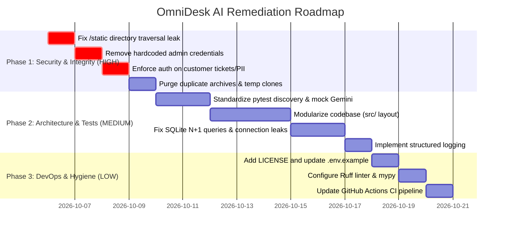

# OmniDesk AI (customer-assistant) — Senior Engineering Code Review & Audit

**Date:** October 5, 2026  
**Auditor:** Senior Software Engineer (AI Systems & Enterprise Architecture)  
**Project:** OmniDesk AI (`customer-assistant`)  
**Repository Path:** `c:\Users\kastu\Desktop\mahesh pro`  

---

## Executive Summary

OmniDesk AI is an enterprise customer service automation platform featuring Retrieval-Augmented Generation (RAG) over corporate policies, server-sent event (SSE) token streaming, ticket escalation, multi-channel intent classification, and an AI agent copilot.

While the core functional concepts and RAG flows demonstrate clear product vision and rich UI styling, the codebase currently suffers from **critical security vulnerabilities** (including arbitrary file disclosure of `.env` and SQLite databases, hardcoded bypass credentials, unauthenticated PII access), **severe repository bloat** (committed binary ZIP archives, full duplicate repository clones, scraped web pages), **monolithic code architecture** (over 4,000 lines spread across 4 flat files), and an **incomplete testing and CI setup** where over half the test suite is bypassed by pytest.

This document details the complete architectural audit, categorized problems with code citations, gaps in professional software hygiene, and an actionable, prioritized improvement roadmap.

---

## 1. What the Project Does & Tech Stack

### 1.1 Functional Purpose
OmniDesk AI serves as an omni-channel customer support orchestration engine designed to deflect repetitive inquiries, enforce verified policy compliance, and assist human support agents.

Key capabilities include:
- **Zero-Hallucination Grounded RAG:** Ingests company documentation ([company_faq.txt](file:///c:/Users/kastu/Desktop/mahesh%20pro/knowledge_base/company_faq.txt)) into a vector database and validates answers with distance guardrails to deflect unverified queries.
- **Real-Time Token Streaming:** Delivers SSE streams to customer clients via `/ask/stream` with citation attachments.
- **Smart Escalation & Ticket Lifecycle:** Creates tracked tickets (`TCK-XXXX`) with SLA urgency calculations, priority triage, and assignment workflows.
- **Agent Copilot & Response Macros:** Generates grounded suggested replies for support specialists with parameterized template macros.
- **Hybrid Retrieval (Dense + Sparse):** Combines dense vector retrieval with BM25 keyword scoring using Reciprocal Rank Fusion (RRF).
- **Multi-Modal Vision Claim Inspection:** Assesses customer hardware damage photos and warranty claims.
- **Enterprise Operations:** Provides CSAT telemetry, synthetic benchmark testing, and outbound incident webhooks.

### 1.2 Technology Stack

| Layer | Technologies & Libraries | Details |
| :--- | :--- | :--- |
| **Backend Framework** | [FastAPI](file:///c:/Users/kastu/Desktop/mahesh%20pro/server.py) (0.115.0+), [Uvicorn](file:///c:/Users/kastu/Desktop/mahesh%20pro/main.py) (0.30.0+), [Starlette](file:///c:/Users/kastu/Desktop/mahesh%20pro/server.py) | High-performance async ASGI API framework |
| **Data Validation** | [Pydantic v2](file:///c:/Users/kastu/Desktop/mahesh%20pro/server.py#L217-L308) (2.7.0+) | Request/response DTO schemas |
| **AI / LLM & Embeddings** | Google GenAI SDK (`google-genai>=1.0.0`) | Gemini 3.6 Flash (`gemini-3.6-flash`), `gemini-embedding-001` |
| **Vector Store** | [ChromaDB](file:///c:/Users/kastu/Desktop/mahesh%20pro/rag_engine.py#L73-L77) (0.5.0+) | Local persistent vector storage (`./chroma_db`) with cosine space |
| **Database & Persistence** | [SQLite3](file:///c:/Users/kastu/Desktop/mahesh%20pro/database.py#L24-L34) (WAL mode) | Relational persistence for tickets, messages, audit logs, CSAT |
| **Secondary Dashboard** | [Streamlit](file:///c:/Users/kastu/Desktop/mahesh%20pro/app.py) (1.37.0+) | Interactive Python command center for internal staff |
| **Primary Frontend SPA** | Vanilla HTML5, CSS3, JavaScript (ES6+) | Tactile Claymorphism UI, SSE EventSource client, Fetch API |
| **Testing** | `pytest`, `pytest-cov`, `pytest-asyncio`, `httpx` / `TestClient` | Integration and regression suites |
| **Deployment / Cloud** | Docker (`.dockerignore`), Railway (`railway.json`), Nixpacks, Procfile | Containerized and PaaS configuration |

---

## 2. Current Folder Structure & Component Breakdown

```
customer-assistant/
├── .github/workflows/ci.yml       # GitHub Actions CI pipeline
├── .dockerignore                  # Docker ignore rules (missing Dockerfile)
├── .env                           # Local environment configuration (contains live keys)
├── .env.example                   # Environment configuration template
├── .gitignore                     # Git ignore rules
├── .markdownlint.json / ignore    # Markdown linter configuration
├── Procfile / start.sh            # Heroku / PaaS startup scripts
├── nixpacks.toml / railway.json   # Nixpacks & Railway deployment manifests
├── package.json / package-lock.json # Node manifests (unused @sentdm dependency)
├── pyproject.toml / pytest.ini    # Python build and test configurations
├── requirement.txt                # Duplicate dependency file (singular)
├── requirements.txt               # Main dependency file (plural)
├── README.md                      # Project documentation and architectural overview
│
├── main.py                        # Uvicorn ASGI entrypoint
├── server.py                      # FastAPI REST & SSE backend application (1,153 lines)
├── database.py                    # SQLite database persistence layer (845 lines)
├── rag_engine.py                  # RAG, BM25, Gemini API, and hybrid search engine (1,059 lines)
├── app.py                         # Streamlit dashboard client (981 lines)
├── archive_project.py             # Packaging script for zip and markdown archives
│
├── index.html                     # Commercial marketing landing page
├── app.html                       # Customer support chat and ticket lookup SPA
├── admin.html                     # Support agent and admin management portal
├── login.html                     # Customer authentication page
├── admin-login.html               # Developer & admin authentication gateway
│
├── css/
│   ├── style.css                  # Master Tactile Claymorphism stylesheet (4,600+ lines)
│   └── cyberpunk.css              # Legacy retro cyberpunk theme stylesheet
├── js/
│   ├── app.js                     # Customer chat and ticket lookup client logic
│   ├── admin.js                   # Admin dashboard, tickets, KB editor logic
│   ├── landing.js                 # Landing page interactions
│   ├── clay-theme.js              # Claymorphism UI dock and tactile sound effects
│   ├── kid-assistant.js           # Interactive UI helper script
│   └── retro-theme.js             # Theme switcher utilities
│
├── knowledge_base/
│   └── company_faq.txt            # Ground-truth corporate policy documentation
├── data/                          # Target directory for SQLite database storage
├── omnidesk.db                    # Stray SQLite database sitting in root
├── chroma_db/                     # Local ChromaDB vector database directory
├── doc/                           # Design specifications, architecture, PRD, task lists
│
├── test_master_suite.py           # Master test runner script
├── test_phase4_features.py        # Intent and CRM export tests (bypassed by pytest)
├── test_phase5_copilot.py         # SLA countdown and copilot reply tests
├── test_phase6_features.py        # Multilingual and macro rules tests
├── test_phase8_features.py        # Hybrid search and vision inspection tests
├── test_production_hardening.py   # Rate limiting and auth tests (bypassed by pytest)
├── test_rag_integration.py        # Core RAG integration tests (bypassed by pytest)
├── test_ticket_escalation.py      # Ticket lifecycle tests (bypassed by pytest)
│
├── [Bloat & Duplicates]
│   ├── omni_desk_ai_archive.zip   # Committed 166KB binary ZIP archive
│   ├── project_archive.zip        # Committed 166KB duplicate binary ZIP archive
│   ├── codebase_archive.md        # Committed 529KB full codebase text dump
│   ├── extracted_text_from_...md  # 2 committed files containing scraped web pages / HTTP 301
│   ├── stitch_customer_assistant_ui_redesign/ # 6 prototype folders from design export
│   ├── ai_support_assistant_claymorphism/     # Root duplicate of prototype export
│   ├── customer_login_sign_up_claymorphism/   # Root duplicate of prototype export
│   ├── developer_admin_gateway_login_sign_up/ # Root duplicate of prototype export
│   ├── tactile_clay_ai/                       # Root duplicate of prototype export
│   ├── tickets_sla_claymorphism/              # Root duplicate of prototype export
│   ├── vision_claim_inspection_claymorphism/  # Root duplicate of prototype export
│   ├── customer-agent-temp/                   # Full 30-file legacy clone containing .git
│   └── node_modules/                          # Leftover npm modules for unused package
```

---

## 3. Problems Identified

### 3.1 Critical Security Vulnerabilities

#### 1. Severe Information Disclosure via Static Root Mount
* **Location:** [server.py:1143-1147](file:///c:/Users/kastu/Desktop/mahesh%20pro/server.py#L1143-L1147)
* **Code:**
  ```python
  if os.path.exists("."):
      try:
          app.mount("/static", StaticFiles(directory=".", html=True), name="static")
      except Exception:
          pass
  ```
* **Impact:** The entire project root is mounted publicly. Any remote client can send `GET /static/.env`, `GET /static/omnidesk.db`, or `GET /static/server.py` and directly download production API keys, the complete customer SQLite database, and server source code without authentication.

#### 2. Permanent Hardcoded Administrative Key Bypass
* **Location:** [server.py:112-115](file:///c:/Users/kastu/Desktop/mahesh%20pro/server.py#L112-L115)
* **Code:**
  ```python
  current_key = globals().get("ADMIN_API_KEY") or os.getenv("ADMIN_API_KEY", "admin-secret-key-2026").strip()
  valid_keys = {k for k in (current_key, os.getenv("ADMIN_API_KEY", "").strip(), "admin-secret-key-2026") if k}
  if token and token in valid_keys:
      return True
  ```
* **Impact:** The key `"admin-secret-key-2026"` is hardcoded into `valid_keys`. Even if a security administrator configures a 64-character high-entropy secret in `.env`, any attacker sending `X-API-Key: admin-secret-key-2026` will permanently bypass administrative authentication.

#### 3. Secrets Embedded in Client-Side Files & Database Seed
* **Locations:**
  - [database.py:835](file:///c:/Users/kastu/Desktop/mahesh%20pro/database.py#L835): Seeds default admin password hash using `"admin-secret-key-2026"`.
  - [js/admin.js:10](file:///c:/Users/kastu/Desktop/mahesh%20pro/js/admin.js#L10): Falls back to `'admin-secret-key-2026'`.
  - [admin.html:33, 38](file:///c:/Users/kastu/Desktop/mahesh%20pro/admin.html#L33): Contains an autofill button that injects `"admin-secret-key-2026"`.
  - [admin-login.html:152, 189, 327, 431](file:///c:/Users/kastu/Desktop/mahesh%20pro/admin-login.html#L152): Plaintext credentials displayed in UI.
  - [server.py:415](file:///c:/Users/kastu/Desktop/mahesh%20pro/server.py#L415): `/api/auth/developer-login` returns the active `admin_key` in plaintext in the JSON response.

#### 4. Unauthenticated Access to Customer PII & Internal Notes
* **Locations:**
  - `GET /api/tickets` ([server.py:574](file:///c:/Users/kastu/Desktop/mahesh%20pro/server.py#L574))
  - `GET /api/tickets/export` ([server.py:652](file:///c:/Users/kastu/Desktop/mahesh%20pro/server.py#L652))
  - `GET /api/tickets/{ticket_id}` ([server.py:725](file:///c:/Users/kastu/Desktop/mahesh%20pro/server.py#L725))
  - `POST /api/tickets/{ticket_id}/messages` ([server.py:778](file:///c:/Users/kastu/Desktop/mahesh%20pro/server.py#L778))
  - `PATCH /api/tickets/{ticket_id}` ([server.py:804](file:///c:/Users/kastu/Desktop/mahesh%20pro/server.py#L804))
* **Impact:** None of these endpoints require authentication. Any unauthenticated attacker can view all customer tickets, download full CSV database exports, read confidential agent notes, post fake messages, and close or reassign tickets.

#### 5. Broken CORS Security Configuration
* **Location:** [server.py:203-211](file:///c:/Users/kastu/Desktop/mahesh%20pro/server.py#L203-L211)
* **Code:**
  ```python
  app.add_middleware(
      CORSMiddleware,
      allow_origins=allowed_origins if allowed_origins else ["*"],
      allow_credentials=True,
      allow_methods=["*"],
      allow_headers=["*"],
  )
  ```
* **Impact:** Setting `allow_credentials=True` with wildcard `allow_origins=["*"]` violates CORS standards, creates cross-origin security risks, and triggers browser rejection in modern user agents.

---

### 3.2 Bad Structure & Architectural Flaws

#### 1. Flat "God Files" Architecture
* No modular Python packaging (`src/` or `app/` with `api/`, `core/`, `models/`, `services/`).
* Business logic, API routing, database queries, and HTML file serving are crammed into four massive files:
  - `server.py`: 1,153 lines
  - `rag_engine.py`: 1,059 lines
  - `app.py`: 981 lines
  - `database.py`: 845 lines
* Static CSS file ([css/style.css](file:///c:/Users/kastu/Desktop/mahesh%20pro/css/style.css)) is a monolithic 4,600+ line stylesheet that is difficult to maintain.

#### 2. Dual Frontend Maintenance Overhead
* The project has two separate, competing frontends:
  - A Vanilla HTML/CSS/JS Single Page Application (`index.html`, `app.html`, `admin.html`).
  - A Streamlit Application (`app.py`, 981 lines) that reimplements the exact same customer chat, ticket list, and KB editor via HTTP calls.
* Maintaining two independent UI implementations introduces duplicate logic, inconsistent UI behavior, and doubled engineering overhead.

#### 3. Unsafe Mutable Global State in Multi-Threaded Server
* **Location:** [rag_engine.py:16-45, 82-98](file:///c:/Users/kastu/Desktop/mahesh%20pro/rag_engine.py#L16-L45)
* Global settings dictionary `CURRENT_SETTINGS` is modified at runtime via `update_pipeline_settings()` using `global EMBEDDING_MODEL...` without thread locking. Concurrent requests in FastAPI will cause race conditions and corrupted runtime parameters.

#### 4. N+1 Database Query Performance Bottleneck
* **Location:** [database.py:284-311](file:///c:/Users/kastu/Desktop/mahesh%20pro/database.py#L284-L311)
* `get_all_tickets()` executes `SELECT * FROM tickets;`, and then in a Python loop executes `SELECT * FROM ticket_messages WHERE ticket_id = ?;` for every ticket. For 1,000 tickets, this executes 1,001 SQL queries sequentially instead of a single SQL `JOIN` or grouped batch query.

#### 5. ID Collision Vulnerabilities via 4-Digit Random Numbers
* **Locations:**
  - `database.py:694`: `user_id = f"USER-{random.randint(1000, 9999)}"` (only 9,000 IDs)
  - `database.py:795`: `req_id = f"DEVREQ-{random.randint(100, 999)}"` (only 900 IDs)
  - `server.py:594`: `ticket_id = f"TCK-{random.randint(1050, 9999)}"`
* Random collisions on SQLite `PRIMARY KEY` trigger unhandled `sqlite3.IntegrityError`, causing sudden HTTP 500 crashes for users.

---

### 3.3 Duplicated Code & Repository Bloat

| Item | Problem | Impact |
| :--- | :--- | :--- |
| **`requirement.txt` & `requirements.txt`** | [requirement.txt](file:///c:/Users/kastu/Desktop/mahesh%20pro/requirement.txt) and [requirements.txt](file:///c:/Users/kastu/Desktop/mahesh%20pro/requirements.txt) are identical 210-byte duplicates. | Confusion on which file is authoritative. |
| **`stitch_customer_assistant_ui_redesign/` & root prototype folders** | 6 prototype folders (`ai_support_assistant_claymorphism`, `customer_login_sign_up_claymorphism`, etc.) exist in root AND are duplicated inside `stitch_customer_assistant_ui_redesign/`. | Redundant files and git history bloat. |
| **`customer-agent-temp/`** | Full clone/snapshot of an older repository version (30+ files), including an internal `.git/` folder and old python files. | ~5MB of dead duplicate code in repository. |
| **Committed ZIP files** | [omni_desk_ai_archive.zip](file:///c:/Users/kastu/Desktop/mahesh%20pro/omni_desk_ai_archive.zip) and [project_archive.zip](file:///c:/Users/kastu/Desktop/mahesh%20pro/project_archive.zip) (166KB each) committed to git. | Violates VCS best practices; inflates clone size. |
| **`codebase_archive.md`** | 529KB markdown file dumping 13,690 lines of project code committed to git. | Bloats repo size; instantly goes out of sync with code. |
| **Scraped Markdown Artifacts** | `extracted_text_from_...customer.md` (an HTTP 301 error page) and `extracted_text_from_...customer_assistant.md` (31KB GitHub web scraping). | Pure repository junk committed to git. |
| **Hardcoded Keyword Dictionaries** | [rag_engine.py:100-113, 340-360, 370-380, 456-505](file:///c:/Users/kastu/Desktop/mahesh%20pro/rag_engine.py#L456-L505) repeats identical keywords and hardcoded response strings across 4 separate functions. | Fragile, unmaintainable keyword matching logic. |

---

### 3.4 Missing Error Handling & Resilience

1. **Leaking Internal Stack Traces to Clients:**
   Multiple endpoints in `server.py` ([server.py:335, 512, 527, 864, 887, 1079, 1090](file:///c:/Users/kastu/Desktop/mahesh%20pro/server.py#L335)) catch exceptions and execute `raise HTTPException(status_code=500, detail=str(e))`. This exposes file paths, internal database details, and library tracebacks directly to external callers.
2. **Silent Failure Swallowing:**
   In [rag_engine.py:167-169](file:///c:/Users/kastu/Desktop/mahesh%20pro/rag_engine.py#L167-L169), API errors during vector generation are caught with `except Exception as e: print(...)` and silently replaced with pseudo-random noise vectors. If an API key expires or is misconfigured, the system silently degrades without raising any alert or failing health checks.
3. **Unsafe SQLite Connection Handling:**
   Functions in `database.py` create connections via `conn = _get_connection()` without using Python context managers (`with conn:`) or `try...finally` blocks. If an unhandled exception occurs inside a query, the connection is never closed, leaking file handles.

---

### 3.5 Missing Input Validation

1. **Missing Email Format Validation:**
   [server.py:271, 292, 296, 300, 305](file:///c:/Users/kastu/Desktop/mahesh%20pro/server.py#L271) validates email fields using only string length (`min_length=3, max_length=120`). Strings like `"123"` or `"notanemail"` are accepted as valid customer emails. Pydantic's `EmailStr` is missing.
2. **Missing Enum Validation for Status and Priority:**
   Ticket priority and status fields accept arbitrary strings instead of strict Enums (`Open`, `In Progress`, `Resolved`; `Urgent`, `High`, `Medium`, `Low`).
3. **Pseudo-Vision Implementation:**
   In [rag_engine.py:1009-1024](file:///c:/Users/kastu/Desktop/mahesh%20pro/rag_engine.py#L1009-L1024), `analyze_claim_image` determines warranty verdict solely based on substring search against `claim_description` before calling the vision model. The actual vision model output only populates `assessment_notes`, leaving the core approval decision driven by naive text keywords.
4. **Memory Exhaustion via Base64 Image Uploads:**
   `VisionClaimRequest.image_base64` accepts strings up to 7,000,000 characters without verifying image magic bytes or streaming to disk.

---

### 3.6 Unused Files & Packages

1. **Unused Node Package:**
   `package.json`, `package-lock.json`, and `node_modules/` contain `@sentdm/sentdm`. This package is not imported or referenced anywhere in any `.py`, `.js`, or `.html` file.
2. **Orphaned Root Database:**
   An SQLite database `omnidesk.db` sits in the project root while active code in `database.py` defaults to `data/omnidesk.db`.
3. **Missing Dockerfile:**
   A `.dockerignore` file exists in root, but there is no `Dockerfile` or `docker-compose.yml`.

---

## 4. What is Missing for a Professional Project

### 4.1 README.md
- **Status:** Comprehensive overview exists (328 lines), but contains critical inaccuracies:
  - Links to a `LICENSE` file that does not exist in the repository (dead link on badge).
  - References 8 phases of architecture, but fails to document environment variables, local setup instructions, or security prerequisites.

### 4.2 Automated Testing
- **Broken Discovery in Pytest:**
  - 4 test files (`test_rag_integration.py`, `test_ticket_escalation.py`, `test_production_hardening.py`, `test_phase4_features.py`) define test suites inside custom functions (`def run_all_tests()`, `def run_ticket_tests()`, `def run_phase4_tests()`) instead of standard `def test_*()` functions.
  - As a result, running `pytest` discovers only 19 test cases, completely ignoring more than 50% of the integration test suite.
- **Absence of Mocking & Long Execution Times:**
  - Tests do not mock external Google Gemini API calls. Running `pytest` took **1 minute 45 seconds (105s)** for just 19 tests because it makes live external API calls over the network.
  - If network access is unavailable, quota is exceeded, or the API key is not configured, the test suite hangs or fails.
- **Test State Pollution:**
  - Tests write directly to the active SQLite database (`data/omnidesk.db`), mutating production/development state and creating inter-test dependencies.

### 4.3 Linting, Formatting & Type Checking
- No linter or code formatter is installed or configured.
- `pyproject.toml` contains empty `[tool.ruff]` and `[tool.pyright]` sections with only exclusions and zero rules.
- Type annotations are incomplete across `server.py` and `database.py`.

### 4.4 Version Control & `.gitignore`
- `.gitignore` misses:
  - Binary ZIP archives (`*.zip`).
  - Markdown codebase bundles (`codebase_archive.md`).
  - Root SQLite database files (`omnidesk.db`).
  - Test coverage artifacts (`.coverage`, `htmlcov/`).

### 4.5 Environment Configuration (`.env.example`)
- `.env.example` is incomplete and out of date:
  - Missing `ADMIN_API_KEY` (defaults dangerously to `"admin-secret-key-2026"`).
  - Missing `RATE_LIMIT_PER_MINUTE`.
  - Missing `DATA_DIR`.
  - Missing `CORS_ALLOWED_ORIGINS`.

### 4.6 License
- **Completely Missing:** There is no `LICENSE` or `LICENSE.md` file anywhere in the repository, despite the README displaying an `MIT License` badge.

### 4.7 Continuous Integration (CI)
- `.github/workflows/ci.yml` contains severe anti-patterns:
  - Hardcodes `ADMIN_API_KEY: admin-secret-key-2026` in workflow YAML.
  - Uses `nohup python server.py > server.log 2>&1 & sleep 6` and `curl` instead of using FastAPI's in-process `TestClient`.
  - Executes `python test_master_suite.py` instead of `pytest` with coverage reporting.
  - Missing linting checks (Ruff), type checks (mypy), and security checks (Bandit / pip-audit).

### 4.8 Logging
- Python's standard `logging` module is completely unused.
- Over **150 raw `print()` statements** are scattered across the codebase.
- No log levels (`DEBUG`, `INFO`, `WARNING`, `ERROR`), no structured JSON formatting, no request correlation IDs, and no log rotation sinks.

### 4.9 Architecture & API Documentation
- While `doc/` contains early design notes, there is no generated OpenAPI/Swagger export, developer onboarding guide, or database migration documentation (e.g. Alembic).

---

## 5. Prioritized Improvement Plan



### Phase 1: Critical Security & Integrity (HIGH Priority — Immediate)
1. **Remove the Dangerous `/static` Root Mount:**
   - Remove `app.mount("/static", StaticFiles(directory=".", html=True))` from [server.py](file:///c:/Users/kastu/Desktop/mahesh%20pro/server.py#L1145).
   - Only mount dedicated static asset folders (`/css` and `/js`).
2. **Eliminate All Hardcoded Admin Credentials:**
   - Remove `"admin-secret-key-2026"` from `valid_keys` in [server.py:113](file:///c:/Users/kastu/Desktop/mahesh%20pro/server.py#L113). Require a non-empty `ADMIN_API_KEY` environment variable.
   - Remove hardcoded autofill buttons and hardcoded credentials from [admin.html](file:///c:/Users/kastu/Desktop/mahesh%20pro/admin.html) and [admin-login.html](file:///c:/Users/kastu/Desktop/mahesh%20pro/admin-login.html).
   - Stop returning `admin_key` in the response of `/api/auth/developer-login`.
3. **Lock Down Customer Endpoints with Proper Authentication:**
   - Add authentication dependencies to `GET /api/tickets`, `GET /api/tickets/export`, `PATCH /api/tickets/{ticket_id}`, and message endpoints.
   - Restrict customer queries to their own authenticated customer session or ticket verification token.
4. **Fix CORS Configuration:**
   - Specify explicit trusted domains or disallow credential passing when using wildcard origins.
5. **Sanitize Exception Responses:**
   - Replace `raise HTTPException(status_code=500, detail=str(e))` with generic error messages (`"An internal server error occurred"`) and log full stack traces internally.
6. **Purge Repository Bloat:**
   - Remove [customer-agent-temp/](file:///c:/Users/kastu/Desktop/mahesh%20pro/customer-agent-temp), [omni_desk_ai_archive.zip](file:///c:/Users/kastu/Desktop/mahesh%20pro/omni_desk_ai_archive.zip), [project_archive.zip](file:///c:/Users/kastu/Desktop/mahesh%20pro/project_archive.zip), [codebase_archive.md](file:///c:/Users/kastu/Desktop/mahesh%20pro/codebase_archive.md), and scraped markdown files from git tracking.
   - Consolidate duplicate prototype folders in root vs `stitch_customer_assistant_ui_redesign/`.
   - Delete duplicate [requirement.txt](file:///c:/Users/kastu/Desktop/mahesh%20pro/requirement.txt) and unused `package.json` / `node_modules/`.

---

### Phase 2: Architecture & Testing Refactor (MEDIUM Priority)
1. **Refactor Test Suite for 100% Pytest Discovery:**
   - Rename custom test runners (`run_all_tests()`, `run_ticket_tests()`, `run_phase4_tests()`) in `test_rag_integration.py`, `test_ticket_escalation.py`, `test_production_hardening.py`, and `test_phase4_features.py` into standard `def test_*()` pytest functions.
   - Move all test files into a dedicated `tests/` directory.
2. **Implement Mocking for Fast, Deterministic Unit Tests:**
   - Create pytest fixtures to mock `google.genai.Client` and embedding generation so tests run offline in <5 seconds without incurring API costs or network timeouts.
   - Use an isolated temporary SQLite database (`sqlite3.connect(":memory:")` or `tmp_path`) for test executions.
3. **Modularize Application Architecture (`src/` Layout):**
   - Split `server.py` into modular FastAPI routers (`api/routers/tickets.py`, `api/routers/rag.py`, `api/routers/auth.py`, `api/routers/admin.py`).
   - Extract Pydantic schemas into `schemas/` and core configuration into `core/config.py` using `pydantic-settings`.
   - Refactor `database.py` queries to eliminate N+1 queries using SQL `JOIN` statements, and wrap all database operations in connection context managers (`with _get_connection() as conn:`).
4. **Replace Unsafe 4-Digit Random IDs:**
   - Replace `random.randint(1000, 9999)` with UUID4 (`uuid.uuid4().hex[:10]`) or cryptographic tokens to prevent primary key collisions.
5. **Implement Enterprise Structured Logging:**
   - Replace all `print()` statements with Python's standard `logging` module configured with log levels, timestamps, and request context.

---

### Phase 3: Code Quality, DevOps & Hygiene (LOW Priority / Polish)
1. **Add LICENSE File:**
   - Add standard MIT `LICENSE` file matching the badge in `README.md`.
2. **Update `.env.example`:**
   - Document all configuration keys: `ADMIN_API_KEY`, `RATE_LIMIT_PER_MINUTE`, `DATA_DIR`, `CORS_ALLOWED_ORIGINS`, `GEMINI_API_KEY`.
3. **Configure Tooling in `pyproject.toml`:**
   - Configure Ruff for linting and formatting (`select = ["E", "F", "I", "W"]`, `line-length = 100`).
   - Configure mypy for type checking.
4. **Modernize GitHub Actions CI Pipeline:**
   - Run `ruff check` and `mypy` in CI.
   - Replace the `nohup uvicorn & sleep 6` script with `pytest --cov=src tests/`.
5. **Provide Production Containerization:**
   - Add a multi-stage production `Dockerfile` and `docker-compose.yml` defining both the backend API and optional reverse proxy.
6. **Unify Frontend Strategy:**
   - Clearly designate the primary interface (the Vanilla SPA) and deprecate or package the Streamlit app (`app.py`) as an optional dev tool.

---

*Report prepared and saved as `AUDIT.md`. Awaiting stakeholder review and approval before proceeding with remediation.*
